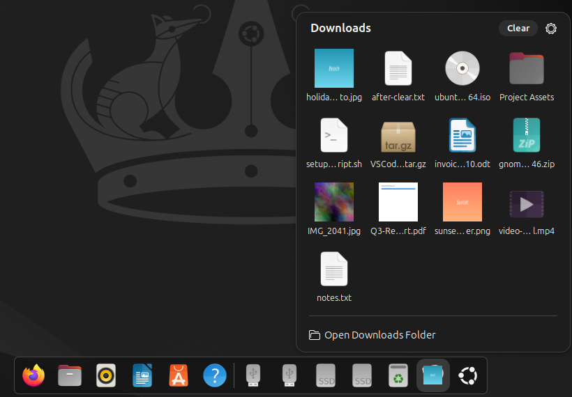
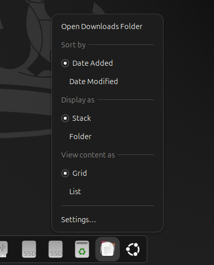
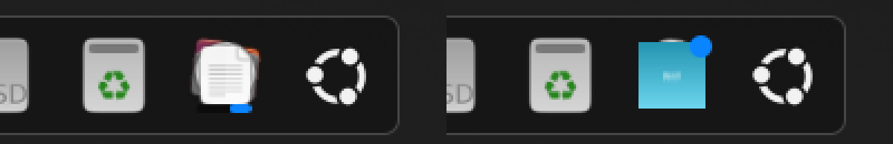

# Downloads Stack for the Dock

A macOS-style Downloads stack for the Ubuntu Dock (or Dash to Dock).

The dock gets a Downloads icon showing your newest downloads as a small pile.
Click it and a grid (or list) of recent downloads opens above the dock, like a
Dock stack on macOS.



## Features

- **Stack icon.** The dock icon shows the newest downloads as a fanned pile, with
  the latest file on top. "Display as: Folder" shows the Downloads folder icon
  instead.
- **Grid or list.** The popover shows recent downloads with real previews
  (images, PDFs, videos, …). The list view adds size, time and the site each file
  came from.
- **Downloads in progress.** `.part` / `.crdownload` files show an animated
  progress bar on the dock icon and in the list, with the current speed.
- **Bounces** when a download finishes, and a blue dot marks downloads you haven't
  seen yet.
- **Click** a file to open it. **Right-click** a file for **Open**, **Open With**
  (every app for that type, default first) and **Show in Files**.
- **Right-click the dock icon** for macOS-style options: Open Downloads Folder,
  Sort by, Display as, View content as, Reset Position in Dock, Settings.
- **Move it** by pressing on the icon and dragging it along the dock, like an app
  icon. Escape while dragging cancels the move.
- **Clear** hides the current downloads from the list. Files are never deleted.
- Follows the dock to every edge, and stays visible while its menus are open, even
  with autohide on.





## Where it goes

By default the icon sits right before the Trash, as on macOS. Drag it anywhere
along the dock to move it: between favourites, after the separator, or after the
Trash.

The spot is remembered relative to its neighbours, not as a slot number, so it
stays put when apps start and quit:

- next to a **favourite**: it stays next to that favourite
- right **before the Trash or a drive**: it stays before it
- next to a **running app**: it follows that app, and falls back to the other
  neighbour when the app quits

"Reset Position in Dock" (right-click the icon, or in Settings) puts it back
before the Trash.

## Requirements

Ubuntu Dock or Dash to Dock must be enabled. If neither is running, the
extension waits and adds its icon as soon as a dock appears. It also re-adds
the icon whenever the dock rebuilds itself (moving the dock, changing monitors,
locking the screen).

It works alongside the top-bar version,
[gnome-shell-downloads-menu](https://github.com/matsch82/gnome-shell-downloads-menu). Both can be enabled
at the same time.

## Install

```sh
make install
```

Then reload GNOME Shell (X11: `Alt+F2`, type `r`, Enter; Wayland: log out and in)
and run:

```sh
make enable
```

`make link` symlinks this folder instead of copying it, for development.
`make nested` opens a nested GNOME Shell window with the extension enabled and
throwaway settings.

## Settings

Open them from the gear button in the popover, "Settings…" in the dock icon's
right-click menu, or `make prefs`.

| Setting | Default |
| --- | --- |
| Downloads folder | XDG Downloads directory |
| View content as | Grid (or List) |
| Sort by | Date Added (or Date Modified) |
| Number of downloads | 16 |
| Generate previews | on |
| Show folders / hidden files | on / off |
| Dock icon: Display as | Stack (or Folder) |
| Bounce when a download finishes | on |
| Dot for new downloads | on |

## Files

| File | Purpose |
| --- | --- |
| `extension.js` | Dock integration, the stack icon, options menu |
| `downloadsView.js` | The popover: grid/list, file right-click menu |
| `downloadsMonitor.js` | Watches the folder, tracks downloads in progress |
| `thumbnailer.js` | Creates missing previews with GNOME's thumbnail factory |
| `prefs.js` | Settings window |
| `stylesheet.css` | Styling |
| `schemas/` | GSettings schema |

## Caveat

There's no official API for adding items to the dock, so this relies on parts of
the Ubuntu Dock / Dash to Dock code that could change: the dock manager it exports,
its dash layout, and its icon-size and menu signals.

To sit between the app icons, the Downloads icon lives in the dock's own row of
icons. The dock's code expects every icon in that row to be an app: it inserts
icons by position and reads each icon's app when you drag apps onto the dock. So
on that row only, the extension wraps four methods (`get_children`,
`get_n_children`, `insert_child_at_index`, `set_child_at_index`) to hide the
Downloads icon from the dock and map positions around it. App drag-and-drop and
running apps work as before. The wrappers are removed when the extension is turned
off.

Tested with Ubuntu Dock 90 on GNOME Shell 46 (Ubuntu 24.04). A future dock update
could need a small fix here.
